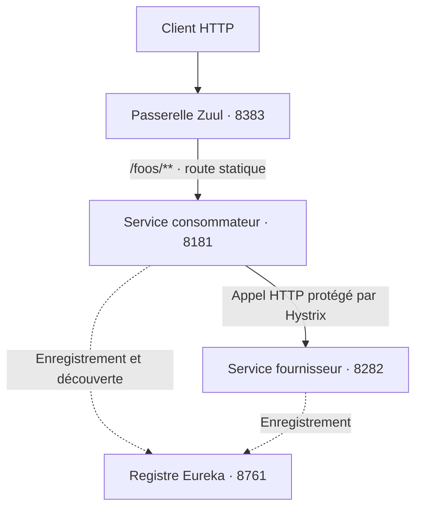

# Spring Cloud Microservices

**Découverte de services, routage HTTP et tolérance aux pannes avec Spring Cloud Netflix.**


## Présentation

Ce projet explore les mécanismes d’une architecture distribuée en Java : enregistrer des services, les découvrir à l’exécution, faire transiter les requêtes par une passerelle et conserver une réponse lorsqu’une dépendance devient indisponible.

Il s’appuie sur **Spring Boot** et **Spring Cloud Netflix**, avec **Eureka** pour la découverte, **Zuul** pour le routage et **Hystrix** pour la protection des appels entre services.

Les endpoints utilisent volontairement des réponses simples pour rendre le comportement de l’infrastructure facile à observer. Le cœur du projet se trouve dans le répertoire **`microServices/`**.

## Architecture



| Module | Rôle | Port |
| --- | --- | --- |
| `microServices/microserv/` | Serveur Eureka : registre des instances. | `8761` |
| `microServices/microserv_1/` | Service fournisseur : renvoie `Hello`. | `8282` |
| `microServices/microserv_2/` | Service consommateur : découvre et appelle le fournisseur. | `8181` |
| `microServices/microserv_3/` | Passerelle Zuul avec Spring Security. | `8383` |

Le consommateur expose également `/loadbal`, qui sélectionne une instance du fournisseur via `LoadBalancerClient` et renvoie son URI. Son endpoint `/` utilise un autre chemin : il prend la première instance retournée par `DiscoveryClient` et l’appelle avec `RestTemplate`.

La passerelle utilise une route statique vers `http://localhost:8181/` ; son routage n’est pas configuré pour résoudre la destination via Eureka.

## Fonctionnalités

- **Enregistrement et découverte** des deux services REST auprès d’Eureka.
- **Communication HTTP** entre le consommateur et le fournisseur, sans adresse du fournisseur codée dans le contrôleur.
- **Sélection d’instance** exposée par un endpoint dédié.
- **Réponse de repli** `default message` lorsqu’un appel protégé échoue.
- **Routage centralisé** des requêtes `/foos/**` par Zuul.
- **Accès authentifié à la passerelle** avec un utilisateur de démonstration en mémoire.

## Stack technique

| Composant | Technologie |
| --- | --- |
| Applications | Spring Boot `2.2.4.RELEASE` |
| Dépendances Cloud | Spring Cloud `Hoxton.SR1` |
| Registre | Netflix Eureka |
| Passerelle | Netflix Zuul |
| Circuit breaker | Netflix Hystrix |
| Appels HTTP | Spring Web, RestTemplate |
| Sécurité de la passerelle | Spring Security |
| Build principal | Maven Wrapper |
| Tests présents | JUnit Jupiter, Spring Boot Test |

Les quatre modules Maven ciblent Java 8. Le dépôt contient aussi une variante Gradle du registre ciblant Java 11. Les instructions suivantes utilisent uniquement les modules Maven pour conserver un parcours cohérent.

## Démarrage local

### Prérequis

- Un JDK compatible avec les versions du projet, idéalement Java 8 pour reproduire la configuration des modules Maven.
- Un accès réseau pour télécharger les dépendances au premier lancement.
- Les ports `8761`, `8282`, `8181` et `8383` disponibles.

Aucune base de données ni aucun compte cloud ne sont nécessaires. Chaque service s’exécute dans un processus distinct.

### 1. Démarrer le registre Eureka

Depuis la racine du dépôt, dans un premier terminal :

```bash
cd microServices/microserv
sh mvnw spring-boot:run
```

Ouvrir [le tableau de bord Eureka](http://localhost:8761/).

### 2. Démarrer le fournisseur

Dans un nouveau terminal, depuis la racine :

```bash
cd microServices/microserv_1
sh mvnw spring-boot:run
```

### 3. Démarrer le consommateur

Dans un nouveau terminal, depuis la racine :

```bash
cd microServices/microserv_2
sh mvnw spring-boot:run
```

Attendre que les instances `microserv_1` et `microserv_2` apparaissent dans Eureka et que la découverte se propage avant de tester les appels.

### 4. Démarrer la passerelle

Dans un nouveau terminal, depuis la racine :

```bash
cd microServices/microserv_3
sh mvnw spring-boot:run
```

Sous Windows, utiliser `mvnw.cmd spring-boot:run` à la place de `sh mvnw spring-boot:run`.

## Vérifier les échanges

### Appel direct au fournisseur

```bash
curl http://localhost:8282/
```

Réponse attendue :

```text
Hello
```

### Appel via le consommateur

```bash
curl http://localhost:8181/
```

Le consommateur recherche le fournisseur dans Eureka, effectue l’appel HTTP et restitue sa réponse `Hello`.

### Sélection d’une instance

```bash
curl http://localhost:8181/loadbal
```

La réponse est l’URI de l’instance sélectionnée. L’hôte exact dépend des informations enregistrées dans Eureka.

### Appel via la passerelle

```bash
curl -u user:password http://localhost:8383/foos/
```

Zuul transmet la requête au consommateur, qui appelle ensuite le fournisseur. La réponse attendue est `Hello` lorsque les services sont disponibles.

Le compte `user` / `password` est défini dans le code pour la démonstration locale. Il doit être remplacé et sa configuration externalisée avant toute exposition du service.

### Observer la réponse de repli

Arrêter le processus du fournisseur `microserv_1`, puis appeler à nouveau le consommateur :

```bash
curl http://localhost:8181/
```

En cas d’échec de l’appel protégé, Hystrix déclenche `defaultMessage()` :

```text
default message
```

Ce repli concerne l’endpoint `/` du consommateur. L’endpoint `/loadbal` ne possède pas de fallback explicite.

## Configuration

Chaque module possède un fichier `src/main/resources/application.yaml`.

| Paramètre | Usage |
| --- | --- |
| `server.port` | Port HTTP du module. |
| `spring.application.name` | Nom d’enregistrement des services REST. |
| `eureka.client.serviceUrl.defaultZone` | Adresse du registre, configurée sur `http://localhost:8761/eureka/`. |
| `zuul.routes.foos.path` | Préfixe public `/foos/**` de la passerelle. |
| `zuul.routes.foos.url` | Adresse du consommateur, configurée sur `http://localhost:8181/`. |

Si les ports ou les noms des services changent, adapter également les références du consommateur et la route Zuul.

## Organisation du dépôt

| Répertoire | Contenu |
| --- | --- |
| `microServices/` | Les quatre applications principales, chacune avec son `pom.xml` et son Maven Wrapper. |
| `TP-netflix-microservice/` | Variante Gradle du serveur Eureka, également configurée sur le port `8761`. |
| `Service1/` | Prototypes Spring Boot complémentaires. |

Démarrer un seul registre sur le port `8761` : la variante Gradle et le registre Maven sont des alternatives.

## Tests

Chaque module principal contient un test de chargement du contexte Spring (`contextLoads`). Pour exécuter les tests d’un module, depuis son répertoire :

```bash
sh mvnw test
```

Ces tests ne couvrent pas encore le parcours complet entre services, le routage authentifié ni les scénarios de panne. Les commandes HTTP ci-dessus constituent un parcours de vérification manuelle ; elles n’ont pas été exécutées lors de la rédaction de cette documentation.

## Évolutions prévues

- [ ] Ajouter des tests d’intégration pour les échanges et la réponse de repli.
- [ ] Utiliser la sélection d’instance dans le chemin principal des appels.
- [ ] Rendre les mises à jour de configuration plus simples et externaliser les identifiants.
- [ ] Configurer explicitement Eureka pour un fonctionnement autonome en local.
- [ ] Ajouter une orchestration Docker Compose pour lancer les quatre composants.
- [ ] Mettre en place une pipeline de compilation et de tests.
- [ ] Enrichir les logs, les métriques et le suivi des requêtes.
- [ ] Moderniser les composants de la stack Spring Cloud.
